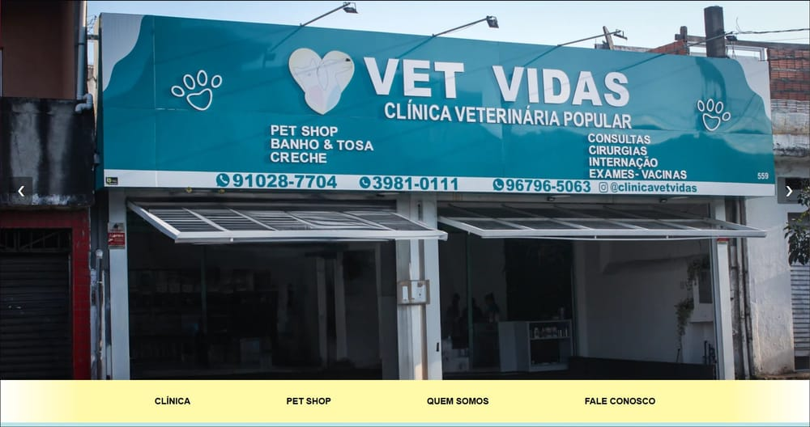

# Site Vet Vidas

Site institucional da **Clínica Popular Vet Vidas**, clínica veterinária e pet shop na Brasilândia, Zona Norte de São Paulo.



**Site no ar:** [clinicapopularvetvidas.com.br](https://clinicapopularvetvidas.com.br)

## Objetivo

Dar à clínica uma presença on-line que apresente os serviços veterinários e do pet shop e leve o visitante a entrar em contato, principalmente pelo WhatsApp.

## Descrição

É um site de página única (one-page), feito só com HTML, CSS e JavaScript, sem frameworks e sem etapa de build. A página é dividida em seções: carrossel de abertura, apresentação da clínica, exames e consultas, creche e hotel, pet shop, "Sobre nós" e rodapé com os contatos. O layout se adapta a celulares, tablets e computadores.

## Principais funcionalidades

- **Carrossel de abertura**: uma versão para desktop e outra para celular, com imagens diferentes. Em telas de até 1060 px aparece a versão mobile. As imagens avançam sozinhas a cada 5 segundos e também podem ser trocadas pelas setas ou arrastando com o mouse ou o dedo.
- **Menu de navegação**: links para as seções Clínica, Pet Shop, Quem Somos e Fale Conosco.
- **Serviços da clínica em abas**: cada botão (cirurgias, ecocardiograma, eletrocardiograma, hemograma, internações, radiografia, ultrassonografia, vacinas e endoscopia) mostra a descrição do serviço sem recarregar a página.
- **Galeria da creche e do hotel**: carrossel de fotos com setas e troca automática a cada 3 segundos.
- **Pet shop**: cards de banho e tosa, leva e traz, convênio próprio da clínica e acessórios.
- **Sobre nós**: texto institucional e vídeo do YouTube incorporado.
- **Rodapé**: menu rápido, horários de atendimento, endereço com link para o Google Maps, links de WhatsApp com mensagem pronta (um para a clínica e outro para o banho e tosa), telefone clicável e links para Facebook e Instagram.
- **Botão flutuante de WhatsApp**: aparece quando a página é rolada.
- **Layout responsivo**: media queries para 1060 px e 535 px.
- **Busca e métricas**: meta description configurada e Google Tag Manager integrado.

## Tecnologias utilizadas

- HTML5
- CSS3 (Flexbox, media queries e transições)
- JavaScript puro (manipulação do DOM, eventos de clique, mouse, toque e rolagem)
- Google Fonts (PT Sans)
- Google Tag Manager
- YouTube (vídeo incorporado) e links `wa.me` do WhatsApp

## Estrutura de pastas

```
.
├── index.html       # página única com todas as seções
├── style.css        # estilos e regras responsivas
├── script.js        # carrosséis, abas de serviços e botão do WhatsApp
├── IMG/             # logotipo, ícones e fotos
│   ├── gallery/     # fotos da galeria Creche & Hotel
│   └── hero-page/   # imagens do carrossel de abertura
└── docs/
    └── preview.jpg  # captura de tela usada neste README
```

## Como executar

Não há dependências para instalar.

1. Clone o repositório:
   ```bash
   git clone https://github.com/Patokaz/VetVida.git
   cd VetVida
   ```
2. Abra o arquivo `index.html` no navegador.

Também dá para usar a extensão **Live Server** do VS Code: abra a pasta do projeto, clique com o botão direito em `index.html` e escolha "Open with Live Server".

A fonte, o vídeo do YouTube e o Google Tag Manager são carregados da internet, então sem conexão eles não aparecem. Os botões de contato levam aos canais reais da clínica.

## Autoria

Desenvolvido por **Raphael Gimenes** ([@Patokaz](https://github.com/Patokaz)) pela [Noff Marketing Digital](https://noffmarketing.com.br), crédito que aparece no rodapé do site.

Cliente: Clínica Popular Vet Vidas. A marca, as fotos e os textos institucionais pertencem à clínica.
